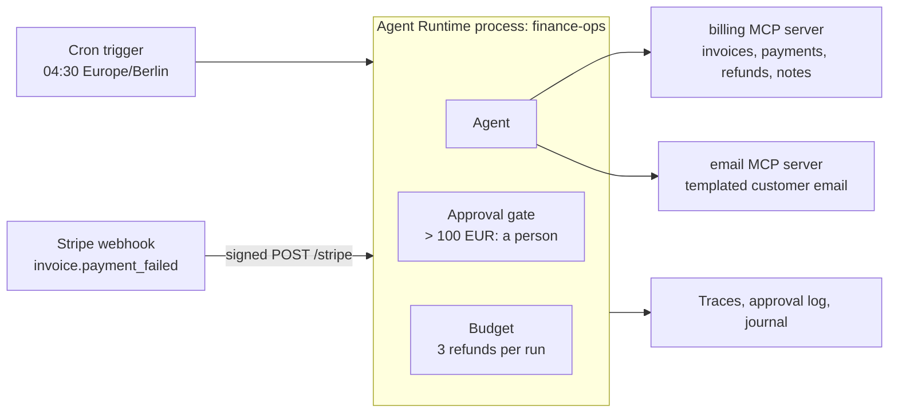

# Invoice reconciliation agent: nightly matching, failed-payment follow-up, capped refunds

A finance operations agent for a subscription business. Every night it matches
yesterday's invoices against payments and refunds. It opens a note for each mismatch
a person must look at. It refunds clear double charges on its own, within limits set
in code. When Stripe reports a failed card payment, it emails the customer a link to
pay and tells the finance team.

The business is Lumen Metrics, a made-up EU analytics SaaS. Its billing system and
email service are small local fakes with realistic seed data, so everything runs
offline.

## What the agent may do on its own, and what it may not

The rules are code. The prompt describes the job; it does not enforce anything.

| Rule | Where it is enforced |
|---|---|
| At most 3 refunds per run. The 4th is refused before it runs, and the agent pauses until finance resumes it. | Autonomy budget: `max_irreversible_per_run=3` in [`finance_agent/rules.py`](finance_agent/rules.py) |
| A refund above 100.00 EUR waits for a person. No answer within the timeout means no refund. | Approval gate with a threshold rule, in the same file |
| Only a duplicate charge can be refunded. A refund that would leave the invoice underpaid is refused. | The billing server: [`fake_systems/billing_server.py`](fake_systems/billing_server.py) |
| Email goes to the address on file, and only for the customer's own invoice. The agent never types an address. | The email server: [`fake_systems/email_server.py`](fake_systems/email_server.py) |
| Only signed Stripe deliveries reach the agent. Replays and other event types are dropped before any model call. | The webhook trigger: `signature_scheme="stripe"` and `filter_expression` in [`finance_agent/process.py`](finance_agent/process.py) |
| Every refund that was not made becomes a high-priority finance note, written by code. | [`finance_agent/hooks.py`](finance_agent/hooks.py) |

## Architecture



- **One process, two triggers.** An `AgentProcess` from the Promptise Agent Runtime
  runs the agent once per event. The cron trigger wakes it at night. The webhook
  trigger takes Stripe's `invoice.payment_failed` events during the day.
- **Two MCP servers.** The billing system and the email service are separate MCP
  servers built with the Promptise MCP server SDK. They share one SQLite file in the
  demo. In production each fronts a real service.
- **Matching is code.** `reconcile_day` is plain Python. The agent decides what to do
  about each mismatch and writes the notes.
- **Three records.** A JSON-lines trace of every LLM turn and tool call, a log of every
  approval decision, and the runtime journal with every refused call.

## Quickstart

### 1. Offline demo (no API key)

```bash
python3.12 -m venv .venv
.venv/bin/pip install -r requirements.txt
.venv/bin/promptise run demo
```

`promptise run demo-trace` runs the same demo with the live trace from `--devtools`.

The demo plays one business day. A `ScriptedModel` from `promptise.testing` sends the
tool calls a good model would send. Everything else is real: the MCP servers, the
signed webhook over HTTP, the approval gate, the budget and the traces.

```text
14:02  Stripe: invoice.payment_failed for in_2049
  webhook answered 202 accepted

04:30  cron: reconcile 2026-10-22
  [approval] finance-ops wants to call refund_duplicate_charge: refund 490.00 EUR on payment ch_2041b (Duplicate charge on in_2041)
  [approval] while it waits, refunds on ch_2041b in the ledger: 0
  [approval] maria@finance approved it

Process state: suspended (reason: budget)
  The fourth refund was refused before it ran. The agent waits for finance.

Refunds made by the agent:
  re_0002  ch_2041b   490.00 EUR
  re_0003  ch_2042b    29.00 EUR
  re_0004  ch_2043b    99.00 EUR

Emails in the outbox:
  hello@jansenbakery.example           payment_failed_retry  in_2049
  billing@brightline-tours.example     refund_issued         in_2041
  finance@casamoreno.example           refund_issued         in_2042
  ap@deltafreight.example              refund_issued         in_2043

Finance notes:
  FN-0001 [normal] Card declined: LM-2049 (Jansen Bakery)
  FN-0002 [normal] Underpaid: LM-2046 (Greta Lindholm)
  FN-0003 [high  ] Marked paid without a payment: LM-2048
  FN-0004 [normal] Payment failed: LM-2049 (Jansen Bakery)
  FN-0005 [normal] Unmatched bank transfer py_9001
  FN-0006 [high  ] Refund not made: ch_2044b
...
Refused before running (journal):
  refund_duplicate_charge(ch_2044b): budget limit max_irreversible_per_run reached (4 > 3)
```

The demo data lives in `.data/demo/`. Each run starts fresh.

### 2. Real run with a model

```bash
cp .env.example .env    # then set OPENAI_API_KEY and STRIPE_WEBHOOK_SECRET
.venv/bin/promptise run start
```

`FINANCE_AGENT_MODEL` picks the model (default `openai:gpt-5-mini`). Any provider
string Promptise supports works, for example `anthropic:claude-sonnet-4-5` with
`ANTHROPIC_API_KEY`.

The process listens on `http://127.0.0.1:8787/stripe` and runs the reconciliation at
04:30 Berlin time. Refunds above 100 EUR are asked at the terminal (`y` to approve).
Set `APPROVAL_WEBHOOK_URL` to send them to your own approval service instead.

To try both paths without waiting for the night, in a second terminal:

```bash
.venv/bin/promptise run reconcile      # live process that reconciles once at start
# in another terminal, with the same STRIPE_WEBHOOK_SECRET in the environment:
.venv/bin/python scripts/send_test_webhook.py
```

With the Stripe CLI you can forward real test-mode events instead:
`stripe listen --forward-to localhost:8787/stripe`.

The live mode still uses the fake billing system in `.data/finance.sqlite`. Delete
that file to start from the seed again.

## Adapt it to your systems

| To connect | Change |
|---|---|
| Stripe, Chargebee or your own ledger | `fake_systems/billing_server.py`: keep the tool names and arguments, replace the SQLite queries with API calls. Keep the duplicate check in `refund_duplicate_charge`. |
| How mismatches are found | `fake_systems/reconcile.py`: your payment timing, partial payments, credit notes and currencies. |
| Postmark, SES or SendGrid | `fake_systems/email_server.py`: replace the `outbox` insert with the provider's send call. Keep the customer check and the once-per-invoice rule. |
| Where finance notes go | `create_finance_note` in the billing server, and `note_refund_not_made` in `finance_agent/hooks.py`: a Jira issue, a Slack message or a row in your back office. |
| Who approves large refunds | `main.py` builds the reviewer. Pass a `WebhookApprovalHandler` (set `APPROVAL_WEBHOOK_URL`) or your own `ApprovalHandler`. |
| The limits | `finance_agent/rules.py`: the threshold, the refunds per run, the daily run cap. |
| The schedule and the webhook port | `Settings` in `finance_agent/process.py`. |

Real servers usually run over HTTP. Replace the `StdioServerSpec` entries in
`mcp_servers()` with `HTTPServerSpec(url=..., bearer_token=...)`.

## Project layout

```text
invoice-reconciliation/
├── main.py                     # the program: --demo, or live with cron + webhook
├── promptise.toml              # scripts and env for `promptise run`
├── finance_agent/
│   ├── process.py              # ProcessConfig: triggers, servers, budget, approval, traces
│   ├── rules.py                # refund threshold, refunds per run, approval audit log
│   ├── hooks.py                # a note for every refund that was not made
│   ├── instructions.py         # the agent's instructions
│   ├── reviewers.py            # the terminal reviewer for large refunds
│   └── demo.py                 # the scripted offline day
├── fake_systems/
│   ├── store.py                # SQLite schema and seed data (the planted mismatches)
│   ├── reconcile.py            # invoice-to-payment matching
│   ├── billing_server.py       # MCP server: invoices, payments, refunds, notes
│   ├── email_server.py         # MCP server: templated customer email
│   └── stripe_sender.py        # Stripe-Signature signing and a tiny sender
├── scripts/
│   ├── send_test_webhook.py    # post the sample event to a running agent
│   └── sample_events/invoice.payment_failed.json
└── tests/                      # pytest, offline
```

## Tests

```bash
.venv/bin/promptise run test        # or: .venv/bin/python -m pytest -q
```

29 tests, about 30 seconds, no API key and no network. They start the real process
with a `ScriptedModel` and check the ledger afterwards:

- `test_reconciliation.py`: the matcher finds exactly the nine planted mismatches, a
  refunded duplicate is not flagged again, and the cron run hands the report to the
  agent and leaves a trace of every step.
- `test_refund_limits.py`: the 4th refund in a run is refused (also when the model asks
  for four in one turn); a refund over 100 EUR waits and does not run when denied or
  unanswered; it runs after approval; the threshold rule at 100.00 EUR.
- `test_webhook.py`: a signed `invoice.payment_failed` emails the right customer; a bad
  signature, a replay and other event types never reach the model; a payload that
  names another customer gets no email.
- `test_systems.py`: the MCP servers' own checks, through `TestClient`.

## Good to know

- **A budget pause stops the webhook path too.** Events keep queueing while the
  process is suspended. That trade-off is on purpose: four double charges in one night
  means something upstream broke. Set `RUNTIME_API_TOKEN` and the live mode serves the
  runtime's control API on port 9100, so finance can resume the agent:

  ```bash
  curl -X POST -H "Authorization: Bearer $RUNTIME_API_TOKEN" \
    http://127.0.0.1:9100/api/v1/processes/finance-ops/resume
  ```
- **A refund waiting for approval blocks the queue.** The process runs one event at a
  time. A night run that waits 30 minutes for a reviewer delays the next webhook by as
  long. Lower `approval_timeout` in `Settings` if that matters to you.
- **Run one copy.** Every process with the cron trigger fires it. Two replicas
  reconcile twice. The duplicate check in the billing server keeps the second run from
  refunding again, but the notes would be doubled.
- **Webhook TLS.** The webhook listens on loopback. Put a TLS reverse proxy in front of
  it before Stripe can reach it.
