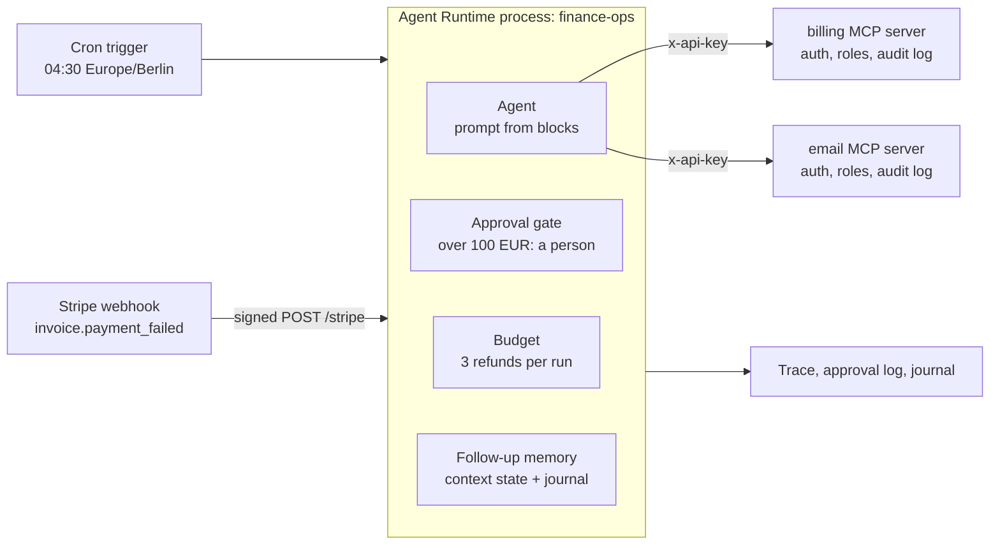

# Invoice reconciliation agent: nightly matching, failed-payment follow-up, capped refunds

> **Reference application.** This is not a finished product. It shows how an invoice
> reconciliation agent can look with Promptise. The billing system and the email
> service are local stand-ins with sample data, not connectors to Stripe or an email
> provider. Replace the adapter files in `fake_systems/` before you use it with real data.

A finance operations agent for a subscription business. Every night it matches
yesterday's invoices against payments and refunds. It opens a note for each mismatch a
person must look at. It refunds clear double charges on its own, within limits set in
code. When Stripe reports a failed card payment, it emails the customer a link to pay
and tells the finance team.

The business is Lumen Metrics, a made-up EU analytics SaaS.

## Quickstart

You need Python 3.10 or newer and a model API key.

```bash
python3.12 -m venv .venv
.venv/bin/pip install -r requirements.txt
cp .env.example .env
```

In `.env`, set three values:

- `OPENAI_API_KEY`, or another provider's key with `FINANCE_AGENT_MODEL` (for example
  `anthropic:claude-sonnet-4-5` with `ANTHROPIC_API_KEY`).
- `STRIPE_WEBHOOK_SECRET`: your endpoint's `whsec_...`, or any long random value to try
  it locally (`openssl rand -hex 32`).
- `PROMPTISE_AUDIT_SECRET`: the key that signs the audit logs (`openssl rand -hex 32`).

Start the agent and reconcile yesterday right away:

```bash
.venv/bin/promptise run reconcile
```

This resets the stand-in billing data to yesterday's sample day. It starts the billing
and email servers on `127.0.0.1:8801` and `:8802` and the agent with its cron and
webhook triggers. The live trace goes to stderr. When the agent asks for a refund above
100 EUR, the terminal asks you: type `y` to approve.

In a second terminal, send Stripe's failed-payment event:

```bash
.venv/bin/promptise run webhook
```

With the Stripe CLI you can forward real test-mode events instead:
`stripe listen --forward-to localhost:8787/stripe`.

`promptise run start` starts the agent without resetting the data or reconciling at once.
It then reconciles at 04:30 Berlin time. Set `FINANCE_CRON="*/5 * * * *"` to watch the
schedule fire sooner.

### What a real run looks like

This is an excerpt of a real run with `openai:gpt-5-mini` (reasoning effort low). The
cron trigger was set to fire at 18:54. Long lines are cut. Repeated calls are folded
into one line. The `#` comments and the typed `y` are added.

```text
finance-ops (openai:gpt-5-mini): cron '54 18 * * *' Europe/Berlin, webhook http://127.0.0.1:8787/stripe. Ctrl+C stops.
▸ finance-ops                                              # the Stripe webhook
  ◆ llm gpt-5-mini-2025-08-07  3.19s  in 1996 out 257 tok  $0.0010  → get_invoice, get_customer
  ⚙ send_customer_email({'customer_id': 'cus_Yf8tH4g', 'invoice_id': 'in_2049', 'template': 'payment_failed_retry'})
  ⚙ create_finance_note({'subject': 'Invoice in_2049 payment failed', ...})
  ⚙ update_state({'key': 'followups', 'value': ['2026-10-23 cus_Yf8tH4g in_2049 payment_failed_retry']})
◂ finance-ops done · 11.20s · 5 llm call(s) · 5 tool call(s) · 12323 tok
▸ finance-ops                                              # the cron trigger at 18:54
  ⚙ reconcile_day({'date': '2026-10-22'})
  ◆ llm gpt-5-mini-2025-08-07  5.90s  in 2743 out 668 tok  $0.0020  → refund_duplicate_charge (5 calls)
  ! approval.granted {"tool_name": "refund_duplicate_charge", ... "reviewer": "auto-classifier", ...}
[approval needed] finance-ops wants to call refund_duplicate_charge: refund 490.00 EUR on payment ch_2041b (Duplicate charge refund for in_2041)
Approve this refund? [y/N] y
  ✓ refund_duplicate_charge 230ms  → {"refund_id": "re_0004", "payment_id": "ch_2041b", "amount": "490.00 EUR", "status": "refunded"}
  ⚙ create_finance_note(...) × 4
  ⚙ send_customer_email(...) × 3
◂ finance-ops done · 67.86s · 9 llm call(s) · 13 tool call(s) · 36957 tok
Budget violation: max_irreversible_per_run (limit=3, current=4), action=pause
audit log billing: 12 entries, intact
audit log email: 4 entries, intact
promptise run · exit 0 · 183.3s · 14 llm call(s) · 49280 tok (in 41149 out 8131) · 18 tool call(s) · 0 error(s) · cost $0.0265
```

The model asked for five refunds in one turn. Two small ones went through on the
threshold rule. The 490 EUR refund waited until the person at the terminal typed `y`.
The fourth and fifth were refused before they ran, and code opened a high-priority note
for each. The process then paused until finance resumed it. One day of work cost about
0.03 USD.

### No key yet?

`promptise run demo-offline` plays the same day with a scripted model from
`promptise.testing`. Everything else is real: the servers, the signed webhook, the
approval gate, the budget and the traces.

## What the agent may do on its own, and what it may not

The rules are code. The prompt describes the job; it does not enforce anything.

| Rule | Where it is enforced |
|---|---|
| At most 3 refunds per run. The 4th is refused before it runs, and the agent pauses until finance resumes it. | Autonomy budget: `max_irreversible_per_run=3` in [`finance_agent/rules.py`](finance_agent/rules.py) |
| A refund above 100.00 EUR waits for a person. No answer within the timeout means no refund. | Approval gate with a threshold rule, in the same file |
| Only a duplicate charge can be refunded. A refund that would leave the invoice underpaid is refused. | The billing server: [`fake_systems/billing_server.py`](fake_systems/billing_server.py) |
| Email goes to the address on file, and only for the customer's own invoice. The agent never types an address. | The email server: [`fake_systems/email_server.py`](fake_systems/email_server.py) |
| Only a key with the `refunds.write` role can refund. A call without a key never reaches a tool. | API-key auth and role guards: [`fake_systems/security.py`](fake_systems/security.py) |
| Only signed Stripe deliveries reach the agent. Replays and other event types are dropped before any model call. | The webhook trigger in [`finance_agent/process.py`](finance_agent/process.py) |
| Every refund that was not made becomes a high-priority finance note, written by code. | [`finance_agent/hooks.py`](finance_agent/hooks.py) |

## Architecture



Each part of Promptise does one job here:

| Part | What it does in this project | File |
|---|---|---|
| Agent Runtime: `AgentProcess`, cron and webhook triggers | Runs the agent once per event, around the clock | `finance_agent/process.py` |
| Autonomy budget | Refuses the 4th refund in a run; caps tool calls and runs per day | `finance_agent/rules.py` |
| Approval gate with `AutoApprovalClassifier` | Small refunds pass on a rule; large ones wait for a person | `finance_agent/rules.py` |
| Runtime hooks and `on_decision` | Turn every refused or denied refund into a finance note | `finance_agent/hooks.py` |
| Prompts as code (`promptise.prompts.blocks`) | Builds the instructions from blocks; the threshold comes from the constant the gate uses | `finance_agent/prompt.py` |
| Context state as memory | Remembers which customers were emailed, across runs and restarts | `finance_agent/process.py` |
| MCP server SDK: `APIKeyAuth`, role guards, `AuditMiddleware` | Each tool checks the caller's role; every call lands in an HMAC-chained log | `fake_systems/security.py` |
| Observability | One JSON line per LLM turn and tool call | `finance_agent/process.py` |
| Journal and control API | Records each trigger, run and refused call; lets finance resume after a pause | `finance_agent/process.py`, `main.py` |

Two parts are not used, on purpose. A mission ends a process when its goal is met, and
this process never finishes. Since 1.9.0 a process can take a Reasoning Engine
pattern (`ProcessConfig(agent_pattern=...)`). This one keeps the default tool loop, because
the day's work is a short, fixed sequence of tool calls.

## Adapt it to your systems

| To connect | Change |
|---|---|
| Stripe, Chargebee or your own ledger | `fake_systems/billing_server.py`: keep the tool names and arguments, replace the SQLite queries with API calls. Keep the duplicate check in `refund_duplicate_charge`. |
| How mismatches are found | `fake_systems/reconcile.py`: your payment timing, partial payments, credit notes and currencies. |
| Postmark, SES or SendGrid | `fake_systems/email_server.py`: replace the `outbox` insert with the provider's send call. Keep the customer check and the once-per-invoice rule. |
| Your identity provider | `fake_systems/security.py`: swap `APIKeyAuth` for `JwksAuth` or `JWTAuth`; keep the roles. |
| Where finance notes go | `create_finance_note` in the billing server, and `note_refund_not_made` in `finance_agent/hooks.py`. |
| Who approves large refunds | Set `APPROVAL_WEBHOOK_URL` to use a `WebhookApprovalHandler`, or pass your own `ApprovalHandler` in `main.py`. |
| The limits | `finance_agent/rules.py`: the threshold, the refunds per run, the daily run cap. |

Your real services usually run elsewhere already. In `main.py`, replace
`start_fake_systems(...)` with your own `HTTPServerSpec(url=..., api_key=...)` entries.

## Project layout

```text
invoice-reconciliation/
├── main.py                     # the application: starts the servers and the agent
├── promptise.toml              # scripts and env for `promptise run`
├── finance_agent/
│   ├── process.py              # ProcessConfig: triggers, budget, approval, memory, traces
│   ├── rules.py                # refund threshold, refunds per run, approval audit log
│   ├── prompt.py               # the instructions, composed from prompt blocks
│   ├── hooks.py                # a note for every refund that was not made
│   ├── reviewers.py            # the terminal reviewer for large refunds
│   └── demo.py                 # the scripted offline day
├── fake_systems/               # stand-ins: replace these with your services
│   ├── store.py                # SQLite schema and sample data (the planted mismatches)
│   ├── reconcile.py            # invoice-to-payment matching
│   ├── billing_server.py       # MCP server: invoices, payments, refunds, notes
│   ├── email_server.py         # MCP server: templated customer email
│   ├── security.py             # API keys, roles and the audit log for both servers
│   ├── launch.py               # starts both servers on 127.0.0.1
│   └── stripe_sender.py        # Stripe-Signature signing and a tiny sender
├── scripts/
│   ├── send_test_webhook.py    # post the sample event to a running agent
│   └── sample_events/invoice.payment_failed.json
└── tests/
```

## Tests

```bash
.venv/bin/promptise run test        # 36 offline tests, about 35 seconds, no key
.venv/bin/promptise run test-live   # 1 real run with your model key, about 2 minutes
```

The offline tests start the real servers and process, with a `ScriptedModel` in place
of the model. They check the ledger afterwards:

- `test_reconciliation.py`: the matcher finds exactly the nine planted mismatches.
- `test_refund_limits.py`: the 4th refund is refused, also from parallel calls. A refund
  over 100 EUR waits. It does not run when denied or unanswered, and runs after approval.
- `test_webhook.py`: a signed event emails the right customer. A bad signature, a replay
  and other event types never reach the model. A forged customer gets no email.
- `test_systems.py`: the servers' own checks, auth, roles and the signed audit log.
- `test_runtime.py`: a real two-second cron schedule fires the process. Memory survives a
  restart. The prompt states the threshold the gate enforces.

`test_live.py` runs a webhook and a nightly run with the real model. It asserts what the
code guarantees, whatever the model writes.

## Good to know

- **A budget pause stops the webhook path too.** Events queue while the process is
  suspended. Set `RUNTIME_API_TOKEN` to serve the control API on port 9100, then resume:

  ```bash
  curl -X POST -H "Authorization: Bearer $RUNTIME_API_TOKEN" \
    http://127.0.0.1:9100/api/v1/processes/finance-ops/resume
  ```

- **A refund waiting for approval blocks the queue.** The process runs one event at a time.
  Lower `approval_timeout` in `Settings` if a late answer would delay other work too much.
- **Reasoning effort.** With the default effort, gpt-5-mini took up to 40 seconds and
  5,000 tokens per step, and the first real day cost 0.11 USD. With
  `FINANCE_AGENT_REASONING=low` the same day cost 0.03 USD.
- **Run one copy.** Every process with the cron trigger fires it. The duplicate check stops
  a second refund, but the notes would be doubled.
- **Webhook TLS.** The webhook listens on loopback. Put a TLS reverse proxy in front of it
  before Stripe can reach it.
